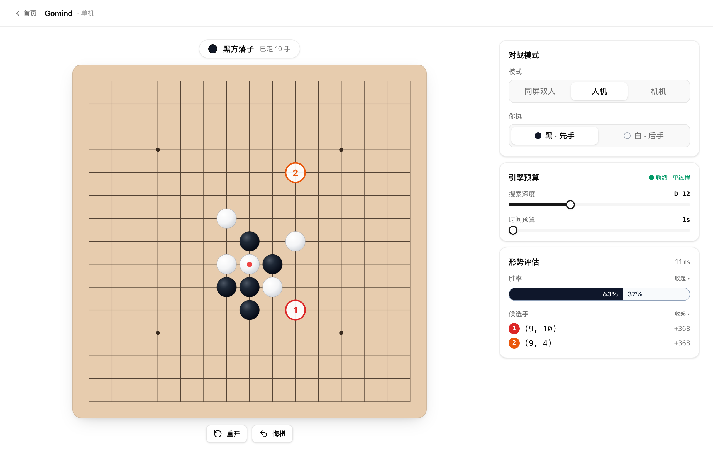
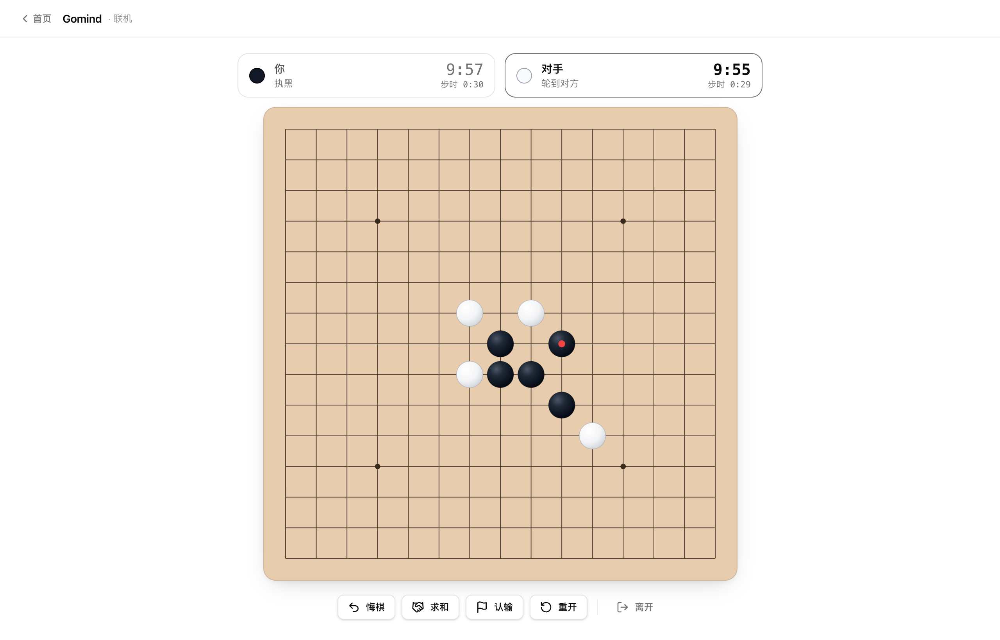

# Gomind

[English](README.md) | **简体中文**

Gomind 是一个基于浏览器的五子棋应用，核心为编译成 WebAssembly 的
[Rapfi](https://github.com/dhbloo/rapfi)（一款基于 NNUE 的高水平五子棋引擎）。引擎完全在浏览器中运行，
服务端仅包含一个用于联机对战的轻量 WebSocket 中转服务。

## 功能

- **本地对战**：两名玩家在同一设备上对弈。
- **人机对战**：与 Rapfi 引擎对弈。
- **引擎自对弈**：观看引擎左右互搏。
- **实时分析**：显示候选着法、局面评估与预估胜率。
- **联机对战**：房主创建房间时选择执子与局时 / 步时，分享四位房间号或链接，着法通过 WebSocket 中转。
  悔棋、重开、求和需对方同意，可认输，超时判负。刷新、断网或关闭标签页后有 90 秒可回到原座位，期间双方停钟。

对局采用无禁手规则，棋盘为 15×15，五子或以上连珠即获胜。

## 截图

**人机对弈**与实时分析：棋盘上标出候选手，并显示形势评估与胜率。



**联机对局**：双方各自计时，悔棋、求和、重开需对方同意。



<p align="center">
  
  &nbsp;&nbsp;
  
</p>

## 技术栈

| 层级 | 技术 |
| --- | --- |
| 引擎 | Rapfi（C++，NNUE）编译为 WebAssembly，在 Web Worker 中运行 |
| 前端 | React 18、TypeScript、Vite |
| UI | Tailwind CSS v4、shadcn/ui |
| 中转服务 | Bun（WebSocket 中转与静态文件服务） |
| 工具链 | Bun workspaces、Biome、Vitest |

## 快速开始

需要 [Bun](https://bun.sh) 1.3 或更高版本。

```bash
bun install
bun run dev          # 启动 Vite 开发服务器
bun run dev:relay    # 可选：在 8765 端口启动中转服务，用于联机对战
```

开发模式下，Vite 会将 `/room/`、`/rooms` 与 `/health` 代理到本地中转服务。预编译的 Rapfi WebAssembly 模块与网络权重
直接由 `web/public/rapfi/` 提供，无需安装原生编译工具链。

## 目录结构

```plaintext
web/      React 前端
relay/    联机对战 WebSocket 中转服务，也可托管构建后的前端
deploy/   Caddyfile、nginx 配置片段、systemd 单元与重新部署脚本
```

## 常用命令

| 命令 | 说明 |
| --- | --- |
| `bun run dev` | 启动前端开发服务器 |
| `bun run dev:relay` | 在本地 8765 端口启动中转服务 |
| `bun run build` | 类型检查并将前端构建到 `web/dist` |
| `bun run start` | 以单一进程同时提供 `web/dist` 与中转服务 |
| `bun run test` | 运行前端单元测试 |
| `bun run lint` | 运行 Biome 检查 |
| `bun run format` | 使用 Biome 格式化代码 |

## 部署

整个应用以单个 Bun 进程运行。`relay/server.js` 通过 `POST /rooms` 分配房间，处理 `/room/<ID>` 上的
WebSocket 连接以及 `/health` 健康检查；设置 `STATIC_DIR` 后，还会托管构建好的前端，并为 SPA 路由提供回退。前端默认连接同源的
中转服务，因此无需额外配置地址。

### Docker Compose（推荐）

```bash
cp .env.example .env
docker compose up -d --build
```

容器默认绑定到 `127.0.0.1:8000`（可通过 `.env` 中的 `BIND` 修改），供已有的反向代理（如 nginx、OpenResty
或 Caddy）回源使用。反向代理必须转发 WebSocket 升级请求头（`Upgrade` 与 `Connection`），且读取超时不少于
120 秒。参考配置见 `deploy/nginx-site.conf.example`。

### 使用内置 Caddy 的 Docker Compose

如果服务器上没有反向代理，可叠加 Caddy 配置以自动启用 HTTPS。在 `.env` 中设置 `DOMAIN`，确保 80 与 443
端口已开放，然后执行：

```bash
docker compose -f docker-compose.yml -f docker-compose.caddy.yml up -d --build
```

如果服务器前面有负责终止 TLS 的 CDN（例如 Cloudflare），请在 CDN 上启用 WebSocket 支持，并将 `DOMAIN`
设为 `:80`，使 Caddy 以 HTTP 向 CDN 提供服务。

### 重新部署到远程服务器

```bash
deploy/deploy.sh <ssh-host> <remote-dir>
```

该脚本会打包当前工作区，通过 SSH 上传，重新构建镜像并重启服务。服务器上已有的 `.env` 不会被覆盖。

### 不使用 Docker

```bash
bun install && bun run build
PORT=8000 bun run start    # 等同于：STATIC_DIR=web/dist bun run relay/server.js
```

如需作为常驻服务运行，可使用 `deploy/gomind.service` 中的 systemd 单元，并在前面放置 Caddy 或 nginx
以提供 TLS。nginx 需要为 `/room/` 转发 WebSocket 升级请求头，并将读取超时设为至少两分钟。

### 前端与中转服务分开部署

前端是纯静态文件，可部署到任意静态托管服务。此时需在构建时设置 `VITE_RELAY_WS_URL` 指向中转服务
（例如 `wss://relay.example.com`），并在中转服务上通过 `ALLOWED_ORIGINS` 限制允许的来源
（例如 `https://app.example.com`）。

### 配置项

| 变量 | 默认值 | 作用范围 | 说明 |
| --- | --- | --- | --- |
| `PORT` | `8000` | 中转服务 | 监听端口 |
| `STATIC_DIR` | 未设置 | 中转服务 | 要托管的静态文件目录；未匹配的路由回退到 `index.html` |
| `ALLOWED_ORIGINS` | `*` | 中转服务 | 允许建立 WebSocket 连接的来源，逗号分隔，支持 `*` 通配 |
| `GRACE_MS` | `90000` | 中转服务 | 掉线玩家的座位保留时长，超时后房间关闭 |
| `DEAD_AFTER_MS` | `15000` | 中转服务 | 连接静默多久视为掉线 |
| `CLAIM_MS` | `20000` | 中转服务 | 新建房间等待房主连接的时长 |
| `MAX_UNCLAIMED` | `200` | 中转服务 | 已创建但房主尚未连接的房间数上限 |
| `BIND` | `127.0.0.1:8000` | Docker Compose | 容器在宿主机上发布的地址与端口 |
| `DOMAIN` | — | Caddy 叠加配置 | Caddy 提供服务并申请证书的域名；设为 `:80` 时使用纯 HTTP |
| `VITE_RELAY_WS_URL` | 同源 | 前端构建 | 中转服务的 WebSocket 基础地址 |

## 说明

Rapfi 目前以单线程模式运行，并启用 WebAssembly SIMD128。仓库中已包含多线程（pthreads）版本，但尚未启用，
原因是在嵌套的 Web Worker 中派生 Emscripten pthread 目前会卡死。单线程版本在 Apple M3 Pro 上约可达到
每秒 13 万节点，足以提供较强的棋力。

## 路线图

- [ ] 对局复盘
- [ ] 棋谱导入与导出

## 致谢

- [Rapfi](https://github.com/dhbloo/rapfi)，由 Rapfi 开发者开发，是所有 AI 功能所用的引擎。
  `web/public/rapfi/` 中的 WebAssembly 构建产物是 [Gomoku Calculator](https://www.gomocalc.com)
  所发布版本的原样副本。
- 神经网络权重来自 [rapfi-networks](https://github.com/dhbloo/rapfi-networks)。

## 许可证

Gomind 自身的源代码采用 [MIT 许可证](LICENSE)。

`web/public/rapfi/` 中随附的第三方文件沿用各自的许可证：Rapfi 引擎构建产物采用 GPL-3.0，
网络权重采用 CC0-1.0。来源、校验值与许可证全文见
[`web/public/rapfi/NOTICE.md`](web/public/rapfi/NOTICE.md)。
